<h1 align="center">CampusCare</h1>

<p align="center">
  <strong>Smart Campus Complaint Management System</strong>
</p>

<p align="center">
  A centralized platform to submit, track, and manage campus complaints with role-based access, automated testing, Docker containerization, and Jenkins CI.
</p>

<p align="center">
  
  
  
  
  
  
  
</p>

<p align="center">
  
  <a href="https://github.com/snehalkhamkar51/CampusCare">
    View Repository
  </a> ·
  <a href="https://github.com/snehalkhamkar51/CampusCare/tree/main">
    Browse Source Code
  </a> ·
  <a href="https://github.com/snehalkhamkar51/CampusCare/issues">
    View Issues
  </a>
</p>

<p align="center">
  <strong>Live Demo:</strong>
  <a href="https://campuscare-d9g9.onrender.com">
    https://campuscare-d9g9.onrender.com
  </a>
</p>

<p align="center">
  <em>
    Hosted on Render. The free instance may take 50 seconds
    or more to wake after inactivity.
  </em>
</p>

<p align="center">
  <em>CampusCare currently runs locally. It is not a publicly hosted application.</em>
</p>

## Table of Contents

- [Project Status](#project-status)
- [Overview](#overview)
- [Problem Statement](#problem-statement)
- [Project Objectives](#project-objectives)
- [Key Features](#key-features)
- [Student and Administrator Workflows](#student-and-administrator-workflows)
- [Technology Stack](#technology-stack)
- [Architecture Overview](#architecture-overview)
- [Project Structure](#project-structure)
- [Application Screenshots](#application-screenshots)
- [Prerequisites](#prerequisites)
- [Local Setup on Windows](#local-setup-on-windows)
- [Creating an Administrator Account](#creating-an-administrator-account)
- [Running Automated Tests](#running-automated-tests)
- [Docker Containerization](#docker-containerization)
- [Persistent SQLite Storage](#persistent-sqlite-storage)
- [Health Endpoint Verification](#health-endpoint-verification)
- [Jenkins CI Pipeline](#jenkins-ci-pipeline)
- [Environment Variables](#environment-variables)
- [Security Notes](#security-notes)
- [Troubleshooting](#troubleshooting)
- [Future Enhancements](#future-enhancements)
- [Contributing](#contributing)
- [License](#license)

## Project Status

CampusCare is a functional local Flask web application. It supports student and administrator authentication, complaint submission and tracking, role-based access control, CSRF protection, automated tests, Docker containerization, and a Jenkins pipeline that runs the test suite. The application is intended for local development and evaluation. It is not deployed to a cloud service or Kubernetes cluster.

## Overview

CampusCare is a student complaint management system built with Flask and SQLite. Students can register, log in, submit campus complaints, and track their own complaint status. Administrators can review all complaints, filter and search them, and update their status through a protected dashboard. The project also includes DevOps tooling for reproducible local deployment and continuous integration.

## Problem Statement

Campus issues are often reported informally through messages, phone calls, or paper forms. This makes complaints difficult to track, prioritize, and resolve. CampusCare provides a single web interface where complaints are recorded consistently, assigned a unique ID, and monitored through clear status values.

## Project Objectives

- Provide a simple complaint submission workflow for students.
- Give administrators a centralized dashboard for reviewing and updating complaints.
- Enforce authentication and role-based access.
- Protect state-changing requests with CSRF tokens.
- Keep complaint data persistent in SQLite.
- Maintain automated tests for core application behavior.
- Containerize the application for reproducible local execution.
- Run automated tests through Jenkins.
## Key Features

| Area | Features |
| --- | --- |
| Authentication | Student registration, login, logout, password hashing, session management |
| Authorization | Student and administrator roles, protected routes, admin-only dashboard |
| Complaints | Unique complaint IDs, categories, priorities, statuses, descriptions, timestamps |
| Student experience | Submit complaints, view personal complaints, track status, view complaint details |
| Administrator experience | View all complaints, search and filter, update complaint status |
| Data integrity | SQLite persistence, safe schema migrations, legacy complaint preservation |
| Security | CSRF protection, HttpOnly session cookies, configurable secure cookies, non-root Docker container |
| Testing | 12 automated Pytest tests covering authentication, authorization, complaints, and health |
| DevOps | Docker image, persistent bind-mounted SQLite storage, Jenkins CI pipeline |

## Student and Administrator Workflows

### Student workflow

1. Register an account.
2. Log in.
3. Open the dashboard and review complaint counts.
4. Submit a new complaint with category, title, description, and priority.
5. View personal complaints and filter by status or priority.
6. Open a complaint to view its details and current status.
7. Log out.

### Administrator workflow

1. Create an administrator account using `create_admin.py`.
2. Log in with the administrator account.
3. Open the Admin dashboard.
4. Review all complaints and summary counts.
5. Search by complaint ID or title.
6. Filter by status, category, or priority.
7. Update a complaint status to Pending, In Progress, or Resolved.
8. Log out.

## Technology Stack

| Layer | Technology |
| --- | --- |
| Backend | Python 3.12, Flask 3.1.3 |
| Web server | Gunicorn 23.0.0 |
| Database | SQLite 3 |
| Frontend | HTML, CSS, Bootstrap 5, Jinja templates |
| Security | Werkzeug password hashing, Flask sessions, CSRF tokens |
| Testing | Pytest 9.1.1 |
| Containerization | Docker with bind-mounted persistent storage |
| CI | Jenkins with a custom Python-enabled Jenkins image |
| Local routing | Caddy reverse proxy for a local hostname |

## Architecture Overview

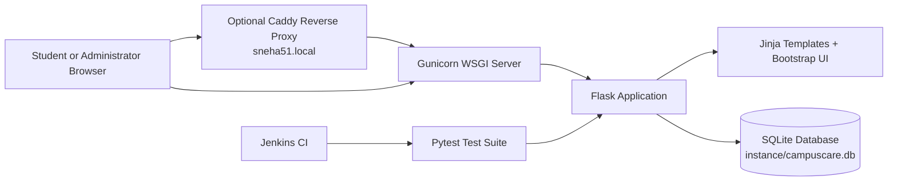

The application uses server-rendered Jinja templates. Flask handles routing, authentication, authorization, CSRF protection, and database access. SQLite stores users and complaints. Docker runs the application through Gunicorn, while Jenkins validates the codebase by running Pytest.

## Project Structure

```text
CampusCare/
├── app.py
├── database.py
├── create_admin.py
├── requirements.txt
├── Dockerfile
├── .dockerignore
├── Dockerfile.jenkins
├── Jenkinsfile
├── Caddyfile
├── static/css/style.css
├── templates/
├── tests/test_app.py
├── screenshots/
└── instance/campuscare.db
```

The `instance/` directory is ignored by Git and contains local runtime data, including the SQLite database. It is intentionally not committed.

## Application Screenshots

| Screenshot | Description |
| --- | --- |
| 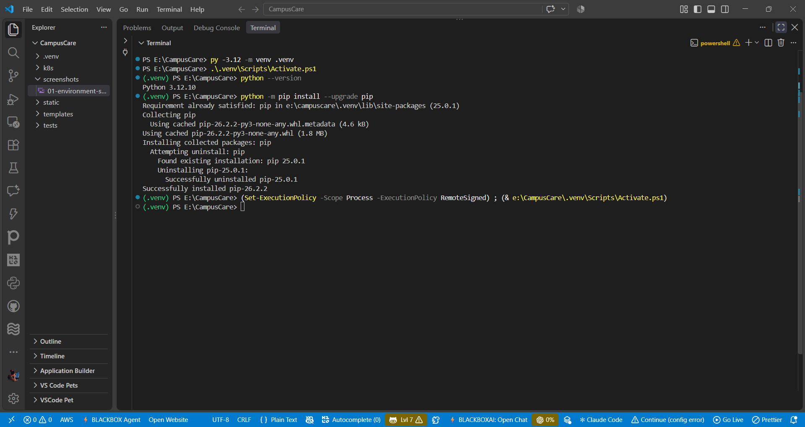 | Local development environment setup |
| 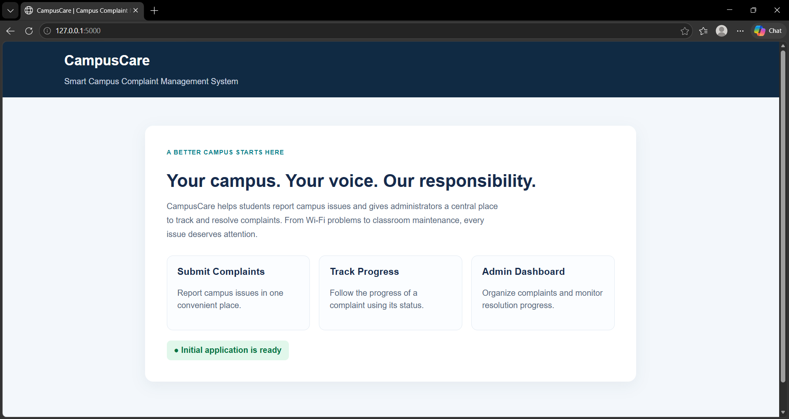 | CampusCare application running locally |
| 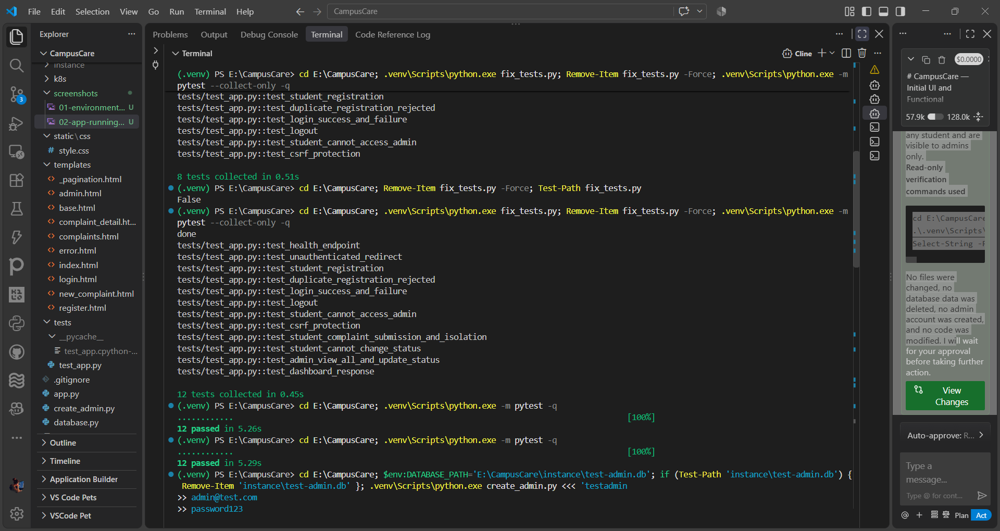 | Automated test results |
| 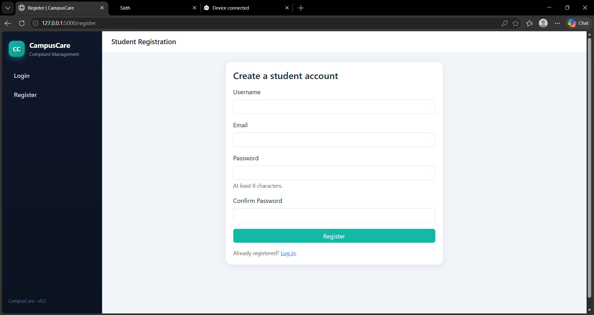 | Student registration page |
| 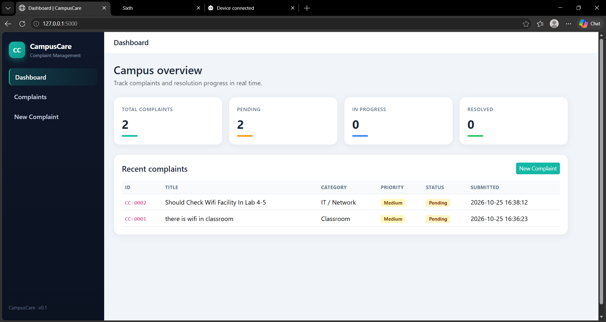 | Student dashboard with complaint summary |
| 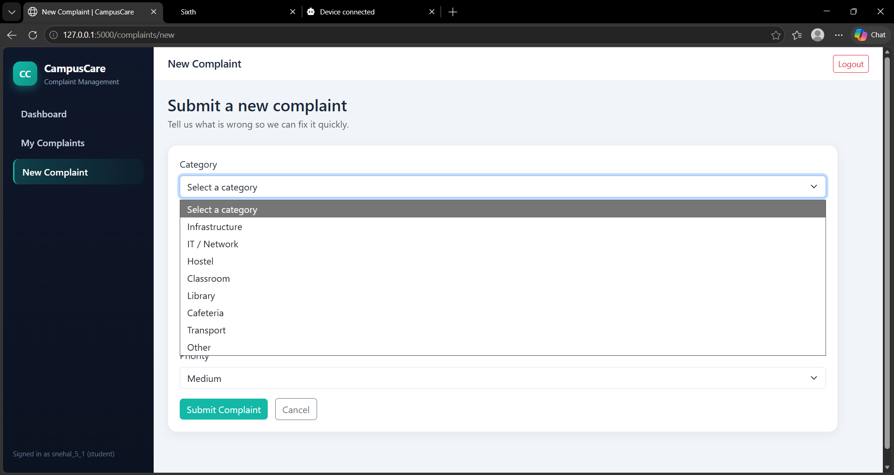 | New complaint submission form |
| 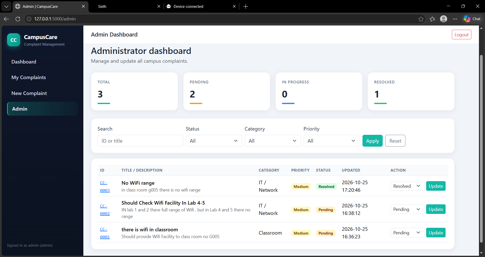 | Administrator complaint management dashboard |
| 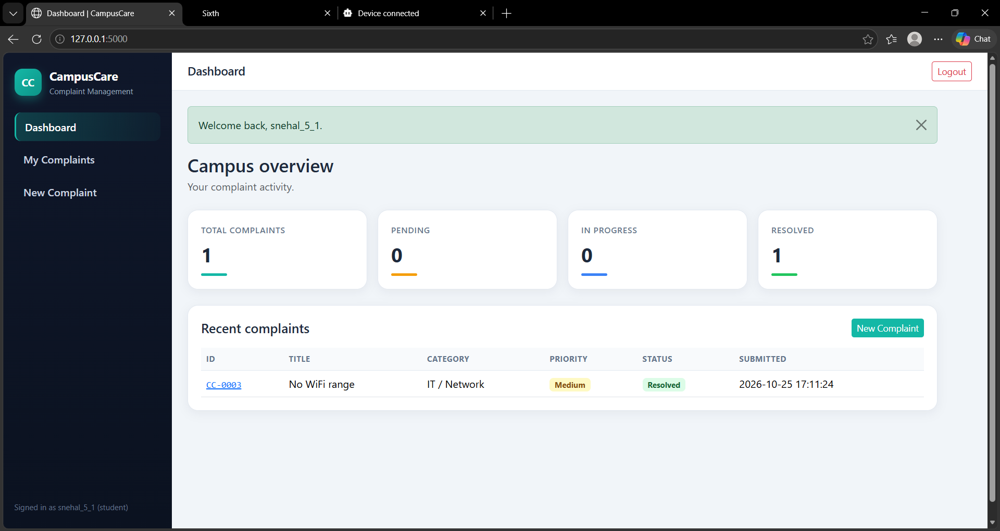 | Complaint status update action |
| 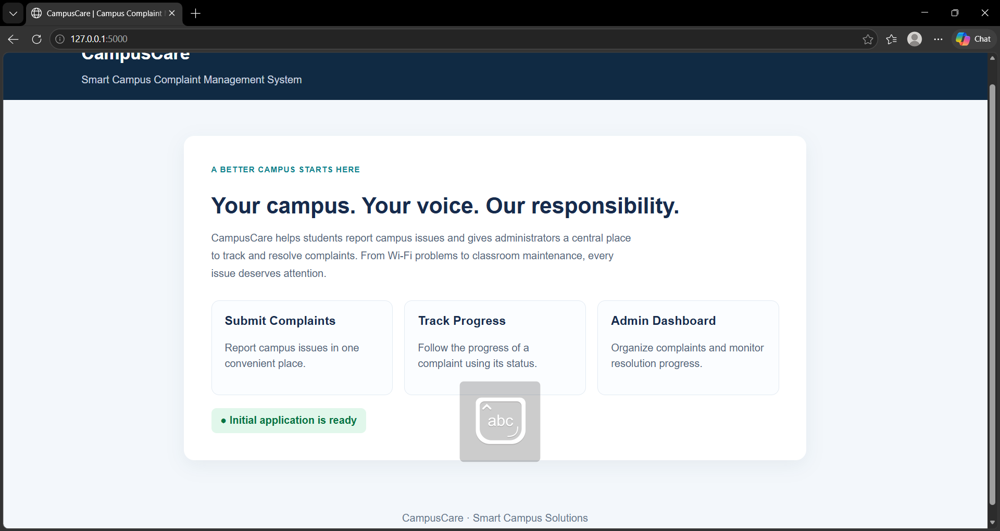 | Docker container running CampusCare |
| 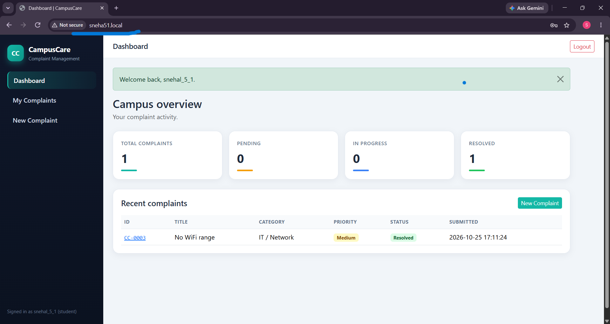 | Optional local hostname via Caddy |
| 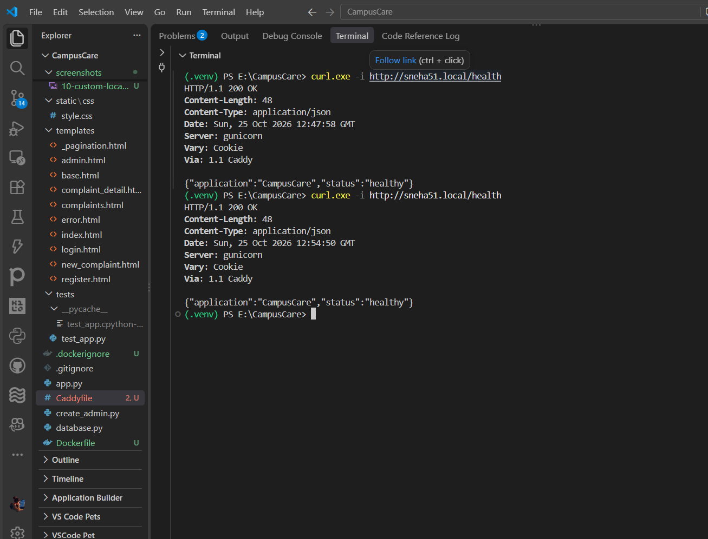 | Health endpoint response from Docker |
| 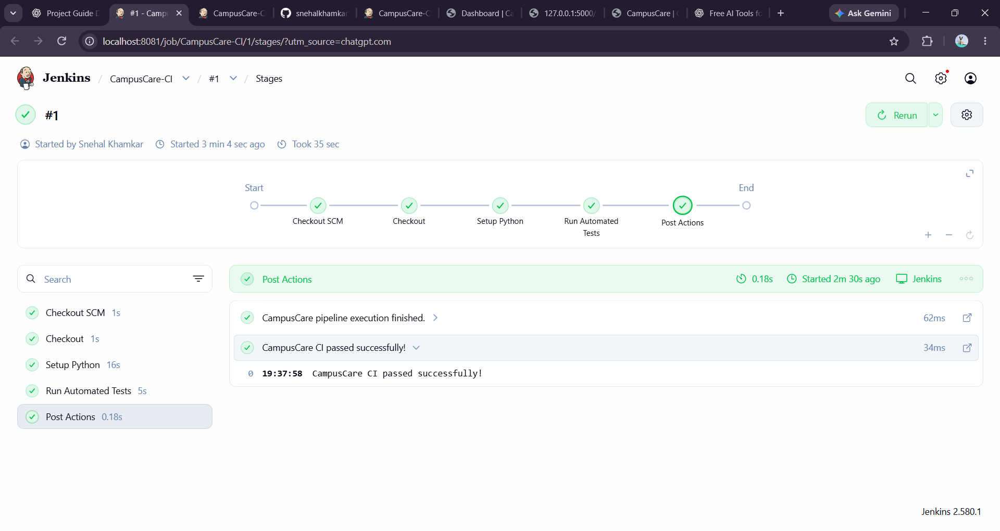 | Successful Jenkins pipeline run |
| 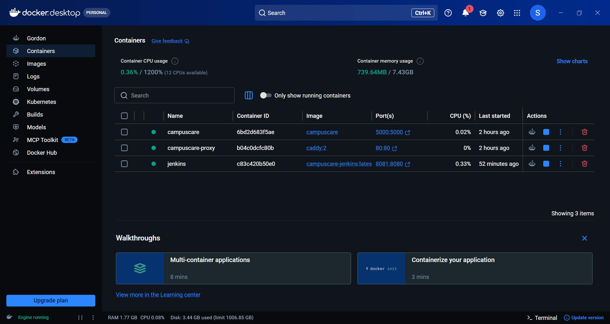 | Docker Evidence |
| 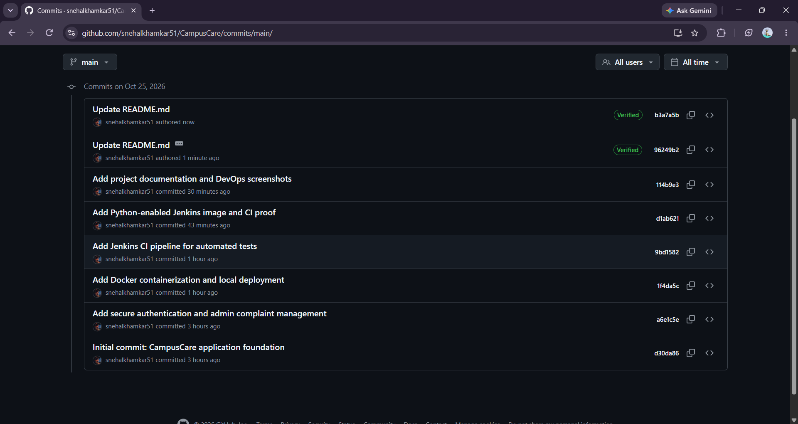 | Commits Evidence|

```

## Prerequisites

- Python 3.12
- PowerShell on Windows
- Git
- Docker Desktop for containerized execution
- Jenkins for CI execution, if running the pipeline locally

## Local Setup on Windows

Clone the repository and create a virtual environment:

```powershell
cd E:\CampusCare
python -m venv .venv
.\.venv\Scripts\Activate.ps1
python -m pip install --upgrade pip
python -m pip install -r requirements.txt
```

If PowerShell blocks script execution, use this for the current shell only:

```powershell
Set-ExecutionPolicy -Scope Process -ExecutionPolicy Bypass
```

Run the Flask application:

```powershell
python app.py
```

The application starts on:

```text
http://127.0.0.1:5000
```

The development server uses the `PORT` environment variable when it is set.

## Creating an Administrator Account

CampusCare does not create an administrator during normal registration. Use the included CLI helper:

```powershell
python create_admin.py
```

The script prompts for a username, email, and password. The password is entered securely and is not displayed. It validates the input and inserts one administrator row into the existing SQLite database. Existing users and complaints are not changed.

## Running Automated Tests

Run the test suite:

```powershell
python -m pytest -q
```

For detailed output:

```powershell
python -m pytest -v
```

The suite currently contains 12 tests covering health, authentication, authorization, complaint submission, complaint isolation, admin access, status updates, and dashboard rendering.

## Docker Containerization

Build the image:

```powershell
docker build -t campuscare .
```

Generate a secret without printing it:

```powershell
$secret = python -c "import secrets; print(secrets.token_hex(32))"
```

Run the container with persistent storage:

```powershell
docker run -d --name campuscare -p 5000:5000 -e "SECRET_KEY=$secret" -v "${PWD}\instance:/app/instance" campuscare
```

Optional Gunicorn worker count:

```powershell
docker run -d --name campuscare -p 5000:5000 -e "SECRET_KEY=$secret" -e "GUNICORN_WORKERS=2" -v "${PWD}\instance:/app/instance" campuscare
```

Stop and restart without losing data:

```powershell
docker stop campuscare
docker start campuscare
```

Remove only the container, not the database:

```powershell
docker rm -f campuscare
```

View logs:

```powershell
docker logs campuscare
```
```

## Persistent SQLite Storage

The container uses a bind mount from the host directory to `/app/instance`:

```text
E:\CampusCare\instance  ->  /app/instance
```

The existing database remains on the host at:

```text
E:\CampusCare\instance\campuscare.db
```

The Docker image does not contain the database. The application initializes tables only when they are missing and applies safe migrations without deleting existing rows. Do not delete, reset, or overwrite `campuscare.db`.

Before running Docker for the first time, verify that the database exists:

```powershell
Test-Path E:\CampusCare\instance\campuscare.db
```

## Health Endpoint Verification

When the application is running through Docker with the documented port mapping, check:

```powershell
curl.exe -s http://localhost:5000/health
```

Expected response:

```json
{"status":"healthy","application":"CampusCare"}
```

The main page at `/` requires authentication and redirects unauthenticated users to the login page.

## Jenkins CI Pipeline

The `Jenkinsfile` defines a declarative pipeline with these stages:

1. Checkout source code.
2. Set up Python using a virtual environment.
3. Install dependencies from `requirements.txt`.
4. Run the automated test suite with Pytest.

The custom Jenkins image in `Dockerfile.jenkins` is based on `jenkins/jenkins:lts-jdk21` and installs Python 3, `python3-venv`, and `python3-pip`. The pipeline has successfully completed all stages with 12 tests passed.

Jenkins currently validates the application and tests. It does not build or deploy the Docker image.

## Environment Variables

The application and container use the following environment variables:

| Variable | Used In | Purpose |
| --- | --- | --- |
| `SECRET_KEY` | `app.py` | Flask session and CSRF signing key. Required for production use. |
| `DATABASE_PATH` | `app.py`, `database.py` | SQLite database file path. |
| `PORT` | `app.py`, `Dockerfile` | Application port. Defaults to `5000`. |
| `GUNICORN_WORKERS` | `Dockerfile` | Number of Gunicorn workers. Defaults to `2`. |
| `SESSION_COOKIE_SECURE` | `app.py` | Set to `1` to mark session cookies as secure over HTTPS. |
| `FLASK_DEBUG` | `app.py` | Set to `1` to enable Flask debug mode during local development. |

Do not store real secret values in source code, screenshots, logs, or committed files.

## Security Notes

- Passwords are hashed with Werkzeug before storage.
- Authentication uses server-side session IDs stored in signed cookies.
- Session cookies are HttpOnly and use SameSite=Lax.
- Secure cookies can be enabled with `SESSION_COOKIE_SECURE=1`.
- CSRF tokens protect login, logout, registration, complaint submission, and status updates.
- Routes are protected by login and role checks.
- Administrators are created only through `create_admin.py`.
- The Docker container runs as a non-root user.
- `SECRET_KEY` must be supplied through the environment and is not baked into the image.
- The database, virtual environment, `.env` files, caches, and screenshots are excluded from the Docker build context.
- Local URLs such as `http://sneha51.local` are for local development only and are not public websites.

## Troubleshooting

| Problem | Suggested Fix |
| --- | --- |
| PowerShell cannot activate `.venv` | Run `Set-ExecutionPolicy -Scope Process -ExecutionPolicy Bypass`, then activate again. |
| Missing Python dependencies | Run `python -m pip install -r requirements.txt` in the activated virtual environment. |
| Port 5000 is already in use | Stop the conflicting process or map a different host port, such as `-p 5001:5000`. |
| Docker cannot write to the database directory | Confirm Docker Desktop file sharing is enabled and the host `instance` folder is writable. The container runs as UID/GID 1000. |
| Database schema errors after updates | Restart the application; `init_db()` applies safe migrations automatically. |
| Tests fail after local experimentation | Remove generated Python cache folders such as `__pycache__` and `.pytest_cache`, then rerun `python -m pytest -q`. Do not delete the database. |
| Jenkins cannot find Python | Use the custom `Dockerfile.jenkins` image, which installs Python 3 and virtual environment support. |

## Future Enhancements

These items are planned, not currently implemented:

- Email notifications for complaint updates.
- File attachments for complaints.
- Advanced reporting and export features.
- Additional administrator role management.
- Improved accessibility and responsive design refinements.
- Optional production database support.
- Expanded CI checks, such as linting and container builds.

Cloud hosting, Kubernetes deployment, and public production deployment are not implemented in this repository.

## Contributing

Contributions are welcome. This repository does not currently include a formal `CONTRIBUTING.md` or code of conduct. Before submitting changes:

1. Create a feature branch.
2. Run `python -m pytest -q` and ensure all tests pass.
3. Avoid committing secrets, `.env` files, virtual environments, caches, or the SQLite database.
4. Keep changes focused and documented.
5. Open a pull request against `main`.


